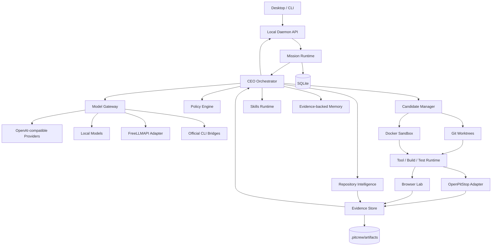

# PitCrew Architecture

## 1. Goals

PitCrew must be:

- local-first;
- provider independent;
- deterministic where facts can be measured;
- event-sourced for recovery;
- sandboxed for agent execution;
- explicit about permissions;
- cheap when tasks are simple;
- able to branch when tasks are uncertain;
- independently verified by OpenPitStop;
- usable from CLI and desktop;
- extensible without turning the core into a plugin jungle.

Hard boundary:

```text
Creation != Verification
```

Generative agents cannot mark their own output VERIFIED.

---

## 2. Recommended stack

```text
pitcrew/
  apps/
    cli/                  # Node 22 + TypeScript + Ink
    desktop/              # Tauri 2 + React + Vite + TypeScript
    daemon/               # Node 22 local orchestration service

  packages/
    protocol/
    mission-runtime/
    orchestrator/
    agents/
    model-gateway/
    repo-intelligence/
    policy-engine/
    sandbox/
    candidate-manager/
    evidence/
    memory/
    skills/
    browser-lab/
    openpitstop-adapter/
    ui-events/
    config/
    observability/

  profiles/
    g4/

  skills/
  fixtures/
  benchmarks/
  docs/
```

Use:

- pnpm workspaces;
- Turborepo;
- TypeScript strict mode;
- Zod runtime schemas;
- SQLite local state;
- content-addressed artifacts;
- Git worktrees;
- Docker for untrusted execution where available;
- Playwright for browser QA.

Keep Tauri Rust thin. Product logic belongs in TypeScript packages/daemon.

---

## 3. High-level system



---

## 4. Process model

### Desktop

Tauri owns only:

- window lifecycle;
- native menus;
- secure bootstrap;
- daemon startup;
- OS integration.

It does not execute arbitrary repository commands.

### Daemon

The daemon owns:

- mission state;
- repository sessions;
- provider adapters;
- policy;
- sandbox;
- agent execution;
- evidence;
- database;
- UI event stream.

### CLI

The CLI:

- starts/connects to daemon;
- renders event stream;
- sends mission/approval/control requests;
- supports headless CI.

---

## 5. Mission runtime

### States

```text
CREATED
UNDERSTANDING
AWAITING_DECISION
PLANNING
AWAITING_APPROVAL
BASELINING
IMPLEMENTING
DEBUGGING
TESTING
RED_TEAMING
VERIFYING
SELECTING
FINAL_GATE
VERIFIED
BLOCKED
NOT_PROVEN
CANCELLED
```

Forbidden transition:

```text
IMPLEMENTING -> VERIFIED
```

A mission must pass independent verification.

### Representative events

```ts
type MissionEvent =
  | MissionCreated
  | RepoObserved
  | RepoFactRecorded
  | DecisionRequested
  | DecisionResolved
  | PlanCreated
  | PolicyEvaluated
  | ApprovalRequested
  | ApprovalResolved
  | SpecialistStarted
  | SpecialistFinished
  | CandidateCreated
  | CandidateChanged
  | ToolStarted
  | ToolFinished
  | TestFinished
  | FindingRaised
  | CandidateEliminated
  | VerificationFinished
  | OpenPitStopVerdictReceived
  | MemoryUpdated
  | FinalVerdictIssued;
```

UI is a projection of events and must never invent status.

---

## 6. Repository intelligence

### Mechanical inventory

Without an LLM:

- git status/branch/HEAD;
- directory tree;
- manifests/workspaces;
- lockfiles/package manager;
- config;
- CI;
- tests;
- Docker/IaC;
- migrations;
- docs/ADRs;
- generated paths;
- CODEOWNERS.

### Structural graph

Use Tree-sitter/language adapters to derive:

- files;
- symbols;
- imports;
- exports;
- references/callers where practical;
- routes;
- schemas;
- tests;
- public interfaces.

Use ripgrep as lexical fallback.

### Facts

```ts
interface RepoFact {
  id: string;
  subject: string;
  predicate: string;
  value: unknown;
  kind: "observed" | "inferred" | "user_declared";
  evidenceRefs: string[];
  observedAt: string;
  sourceDigest?: string;
  invalidationRules: InvalidationRule[];
}
```

### Context Pack

Model request receives only relevant:

- mission;
- repo facts;
- target symbols/files;
- nearest patterns;
- tests;
- interfaces;
- recent failures;
- decisions;
- current diff.

Do not dump the whole repository into every prompt.

---

## 7. Runtime roles

"Agent" means a bounded role, not an unrestricted employee.

### CEO / Coordinator

- never directly edits;
- decomposes mission;
- selects specialists;
- manages budget;
- decides when to branch;
- asks material user decisions;
- consumes evidence;
- cannot mark VERIFIED.

### Repository Scientist

Read-only except disposable experiment branches.

- discovers architecture;
- finds patterns;
- builds assumptions;
- runs falsification experiments;
- produces Blindspot Map.

### Architect

Read-only.

- change contract;
- architecture impact;
- migrations/API compatibility;
- decides if multi-candidate experiment is justified.

### Implementer

Write access only to approved candidate worktree/scope.

### Debugger

Activated after repeated non-progress.

### Test Engineer

May add/update tests aligned with acceptance criteria. Cannot weaken tests without explicit justification.

### Browser QA

Controls PitCrew-managed browser contexts and authorized origins only.

### Security Specialist

Produces threat model and invokes approved scanners/probes. Does not grant itself network scope.

### OpenPitStop

Not an LLM agent. Independent referee adapter.

---

## 8. Model gateway

```ts
interface ModelRequest {
  missionId: string;
  role: AgentRole;
  taskType: TaskType;
  messages: Message[];
  contextRefs: ContextRef[];
  tools?: ToolDefinition[];
  outputSchema?: JsonSchema;
  risk: "low" | "medium" | "high";
  latency: "fast" | "normal" | "deep";
  budget: {
    maxInputTokens?: number;
    maxOutputTokens?: number;
    maxCostUsd?: number;
    deadlineMs?: number;
  };
  preferredProfile?: "economy" | "balanced" | "deep" | "local";
}
```

Provider interface:

```ts
interface ModelProvider {
  id: string;
  capabilities(): Promise<ModelCapability[]>;
  listModels(): Promise<ModelInfo[]>;
  complete(request: NormalizedModelRequest): AsyncIterable<ModelEvent>;
  health(): Promise<ProviderHealth>;
}
```

Adapters:

- `openai-compatible`
- `ollama`
- `lmstudio`
- `freellmapi`
- `cli-bridge`
- `gemma-g4-profile`

Routing uses:

- role;
- risk;
- context;
- tools;
- spend ceiling;
- provider health.

Cheap/local model may summarize mechanics. Difficult reasoning can escalate. Verification never becomes easier because a cheaper model was used.

---

## 9. FreeLLMAPI

Treat as an OpenAI-compatible provider preset.

```yaml
providers:
  freellmapi:
    type: openai-compatible
    base_url: http://127.0.0.1:4000/v1
    api_key_ref: keychain:freellmapi
    enabled: true
```

Port is configurable. Never assume a fixed deployment.

Rules:

- PitCrew does not bundle upstream credentials.
- PitCrew does not promise continued free-model availability.
- Direct/local providers can replace it without changing orchestration.
- No NVIDIA integration is required.

---

## 10. Official CLI bridges

Some users prefer authenticated CLIs/subscriptions.

```ts
interface CliBridge {
  detect(): Promise<DetectionResult>;
  capabilities(): Promise<CliCapability[]>;
  run(task: CliTask, sandbox: SandboxRef, limits: Limits): Promise<CliRunResult>;
}
```

Rules:

- invoke official user-installed executable;
- do not inspect private auth storage;
- do not extract cookies/tokens;
- do not impersonate unsupported API access;
- use documented CLI invocation;
- preserve upstream permission/cost controls;
- label experimental bridges when automation terms are unclear.

A CLI bridge is an external worker, not a credential source.

---

## 11. Policy engine

```ts
interface ProposedAction {
  actor: AgentRole;
  type: ActionType;
  target: string;
  candidateId?: string;
  riskHints: string[];
}
```

Decision:

```ts
type PolicyDecision =
  | { decision: "allow"; constraints?: Constraint[] }
  | { decision: "ask"; approvalType: string; reason: string }
  | { decision: "deny"; reason: string };
```

Default matrix:

| Action | Default |
|---|---|
| Read normal source | Allow |
| Search repository | Allow |
| Run known test in sandbox | Allow |
| Edit approved source in candidate | Allow |
| Add dev dependency | Ask if lockfile changes |
| Add runtime dependency | Ask |
| Change auth/authorization | Ask |
| Migration/schema change | Ask |
| CI/deployment/IaC | Ask |
| Read secret values | Deny |
| Push/merge | Ask |
| Production deploy | Deny in MVP |
| Destructive host command | Deny |
| Active external security testing | Deny unless scoped approval |

Repository files cannot override these rules.

---

## 12. Sandbox and candidates

### Baseline

Capture:

- base commit;
- dirty state;
- relevant config;
- repository digest;
- plan/policy identity.

Dirty repositories require explicit handling.

### Isolation

Default:

```text
Git worktree + Docker where execution containment is required
```

Worktree gives independent Git/filesystem state.

Docker provides process/network containment.

### Docker policy

- no Docker socket;
- no host home;
- sanitized env;
- CPU/memory/PID/time limits;
- non-root where practical;
- workspace only as needed;
- network disabled by default;
- explicit network profiles for dependency install/integration.

### Lifecycle

```text
BASELINE
 -> CANDIDATE_CREATED
 -> IMPLEMENTING
 -> VERIFYING
 -> SURVIVED | ELIMINATED
 -> SELECTED
 -> APPLIED | DISCARDED
```

No automatic merge in MVP.

---

## 13. Candidate Arena

Branch adaptively.

Create another candidate when:

- root-cause confidence weak;
- material architecture alternatives;
- first candidate lacks discriminative evidence;
- repeated non-progress;
- high-risk change justifies independent approach;
- G4/PBTS profile says proof is weak and budget remains.

Do not branch trivial work.

---

## 14. Evidence architecture

Artifacts are content-addressed.

```text
.pitcrew/
  pitcrew.db
  artifacts/
    sha256/
  cache/
  config.yaml
```

Evidence includes:

- candidate identity;
- tool/command identity;
- timestamps;
- stdout/stderr refs;
- file hashes;
- test results;
- OpenPitStop refs;
- browser traces;
- approval refs.

Large bodies live as files, not DB blobs.

---

## 15. OpenPitStop adapter

OpenPitStop stays separate.

```ts
interface RefereeAdapter {
  detect(repo: string): Promise<RefereeCapabilities>;
  understand(input: RepoRef): Promise<EvidenceRef>;
  architecture(input: CandidateRef): Promise<VerdictRef>;
  verifyStack(input: CandidateRef): Promise<VerdictRef>;
  baselineVerify(input: BaselineVerificationInput): Promise<VerdictRef>;
  acceptanceVerify(input: AcceptanceInput): Promise<VerdictRef>;
  regressionCheck(input: RegressionInput): Promise<VerdictRef>;
  integrity(input: CandidateRef): Promise<VerdictRef>;
  holdout(input: HoldoutInput): Promise<VerdictRef>;
  verifierCheck(input: VerifierInput): Promise<VerdictRef>;
  gate(input: GateInput): Promise<FinalVerdict>;
}
```

Initial implementation shells out to OpenPitStop CLI JSON output.

Do not import private OpenPitStop internals.

---

## 16. Browser Lab

Use Playwright.

```ts
interface BrowserEvidence {
  scenarioId: string;
  candidateId: string;
  browser: string;
  viewport: string;
  steps: BrowserStep[];
  expected: string;
  actual: string;
  consoleArtifact?: string;
  networkArtifact?: string;
  traceArtifact?: string;
  screenshots: string[];
  accessibilityArtifact?: string;
}
```

Targeting order:

1. accessibility roles/tree;
2. stable project test IDs;
3. visible labels/text;
4. vision only when semantic targeting is insufficient.

Exploratory findings must be reproduced before becoming durable defects.

---

## 17. Memory

Layers:

```text
L0 session scratch
L1 mission memory
L2 folder/subsystem memory
L3 project memory
L4 explicit user decisions
```

Every durable memory item has:

- evidence;
- observed commit/digest;
- invalidation rules;
- confidence class.

Never persist secrets.

---

## 18. Repo Story and Blindspot Map

Repo Story uses structural graph + evidence.

Blindspot Map adds assumptions and verifier strength.

Assumption status:

```text
PROTECTED
INFERRED
UNPROTECTED
EXTERNAL_VOLATILE
CONTRADICTED
```

Example:

```yaml
id: A-TEAM-INVITE
claim: only team admins can invite users
source: user_requirement
status: PROTECTED
verification_refs:
  - holdout-authz-invite
invalidated_by:
  - src/auth/**
  - src/team/**
```

---

## 19. Local API

Preferred:

- loopback HTTP for request/response;
- WebSocket for event stream;
- random port;
- per-daemon bearer token;
- Unix socket/named pipe later.

Event order is authoritative.

---

## 20. Degradation modes

### No Docker

Allow read-only intelligence. Reduced-isolation worktree execution only with explicit user enablement.

### No OpenPitStop

PitCrew may inspect/plan/build but cannot issue VERIFIED. Final state is NOT_PROVEN.

### Provider unavailable

Fail over only to another user-configured compatible provider within budget/policy.

### FreeLLMAPI rate limited

Fail over to local/direct provider if configured. No infinite retry.

### Browser unavailable

Browser QA is NOT_CONFIGURED, not pass.

### Environment failure

Classify separately from behavioral failure.

---

## 21. PitCrew-G4 architecture profile

`profiles/g4/` overrides:

- provider: competition Gemma model only;
- tools: competition-provided tools;
- sandbox: competition environment;
- budget: shared competition budget;
- final action: competition `submit_patch`;
- provider routing: disabled;
- desktop: excluded;
- OpenPitStop full CLI: replaced by tiny deterministic competition scripts where full CLI overhead hurts score.

G4 is a profile/experiment. It must not force competition constraints into the general OSS core.
