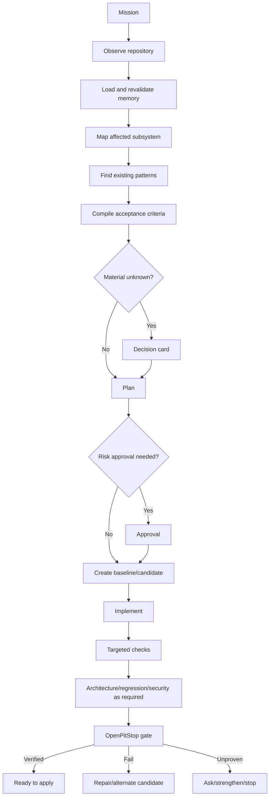

# PitCrew App Flow and Working Model

## 1. Core experience

User experiences one engineering mission, not a group chat.

```text
User
 -> CEO
 -> Understanding
 -> Material decisions
 -> Plan
 -> Candidate work
 -> Tests / QA
 -> OpenPitStop
 -> Outcome
```

Specialists are visible as work units, not noisy personalities.

---

## 2. First launch

### Capability check

PitCrew checks:

```text
Git
Node
Docker
OpenPitStop
Playwright/browser support
configured providers
local models
```

Example:

```text
Ready
✓ Git
✓ Node 22
✓ OpenPitStop
✓ Ollama

Optional
○ Docker not installed
○ Browser Lab not initialized
```

Never show unavailable dependency as available.

### Provider

Options:

```text
Use local model
Connect OpenAI-compatible endpoint
Connect FreeLLMAPI
Detect supported installed CLI
Configure later
```

Configure later permits read-only Repo Story.

### Open repository

```bash
pitcrew open .
```

Observe without writes.

### Learning mission

Suggested:

> Explain this repository.

Demonstrates value safely.

---

## 3. Existing feature flow

User:

> Add team invitations with a seven-day expiry.



---

## 4. Bug-fix flow

User:

> Checkout occasionally creates two orders.

PitCrew:

1. observe checkout path;
2. identify concurrency/business assumptions;
3. search tests;
4. reproduce;
5. require failing baseline when possible;
6. generate root-cause hypotheses;
7. choose one candidate for simple case;
8. branch if uncertainty/risk warrants;
9. run same reproduction;
10. run regression scope;
11. run OpenPitStop;
12. present selected candidate.

Ideal evidence:

```text
Baseline
FAIL: concurrent requests created 2 orders

Candidate B
PASS: concurrent requests created 1 order

Regression
PASS

Architecture
PASS

OpenPitStop
VERIFIED
```

If baseline does not reproduce, outcome is NOT_PROVEN, not FIXED.

---

## 5. Repeated failure

### First failure

Classify deterministically:

```text
assertion failure
type error
missing dependency
environment
timeout
syntax
lint
unknown
```

Give evidence back to current implementer if it contains new information.

### Second non-progress attempt

Stop local random patching.

Activate Debugger:

- fresh root-cause model;
- reopen assumptions;
- broaden call graph;
- query failure memory;
- decide whether Candidate B is justified.

### Budget exhausted

Return BLOCKED with:

- attempts;
- evidence;
- unresolved question;
- recommended next action.

No infinite retries.

---

## 6. Candidate Arena

Arena is adaptive.

Triggers:

- two plausible architectures;
- weak reproduction;
- high-risk subsystem;
- repeated failure;
- proof remains weak.

```text
Immutable baseline
      |
   +--+--+
   |     |
   A     B
   |     |
 verify verify
   |     |
 eliminate/survive
      |
 OpenPitStop final gate
```

Example:

```text
Candidate A
Approach: application-level mutex
Target test: PASS
Concurrency stress: FAIL
Eliminated

Candidate B
Approach: DB uniqueness + transaction
Target test: PASS
Concurrency stress: PASS
Regression: PASS
Survives
```

Selection is evidence-first.

---

## 7. Blindspot discovery

User:

> What can this repo fail to catch?

Repository Scientist:

1. list important assumptions;
2. map existing verifiers;
3. create bounded mutation in disposable branch;
4. run relevant verifier;
5. mark protection;
6. discard branch.

Example:

```text
Assumption
Only admin can invite member.

Mutation
Remove admin check.

Existing suite
PASS

Result
UNPROTECTED

Recommended
Add authorization holdout.
```

---

## 8. New application

User:

> Build a simple appointment booking app for a dental clinic.

PitCrew does not immediately create dozens of files.

### Product brief

Extract:

- primary users;
- outcomes;
- core journeys;
- data;
- material risks.

### Decisions

Ask only material unknowns.

### Build Contract

```yaml
users:
journeys:
architecture:
data_model:
security_assumptions:
ui_states:
acceptance:
out_of_scope:
```

User approves/edits.

### Vertical slices

Example:

1. appointment creation;
2. conflict prevention;
3. admin availability;
4. cancellation;
5. Browser QA;
6. security/verification.

No speculative features.

---

## 9. Production readiness

User:

> Is this ready to deploy?

PitCrew runs a profile:

```text
build
test layers
typecheck
lint
OpenPitStop
migration safety
security
browser critical journey
observability checks
deployment config
rollback readiness
```

Outcome:

```text
READY
BLOCKED
NOT PROVEN
```

Example:

```text
NOT PROVEN

Passed
✓ build
✓ unit
✓ integration
✓ OpenPitStop architecture

Missing
○ production migration dry-run
○ critical browser journey

Blocked
none
```

---

## 10. High-risk action

Examples:

- auth;
- authorization;
- payments;
- migration;
- runtime dependency;
- CI;
- infrastructure;
- network scope;
- production action.

UI:

```text
APPROVAL REQUIRED

Candidate changes users.role permissions.

Why this is high risk
A mistake can grant access across tenants.

Plan
- update authorization predicate
- add cross-tenant denial test
- run auth holdout

[Approve candidate-only change]
[Change plan]
[Cancel]
```

Approval binds to action. Plan change requires new approval.

---

## 11. Browser QA

Browser Scientist receives:

- acceptance;
- personas;
- routes;
- candidate;
- risk map.

Scenario families:

- happy;
- invalid;
- timeout;
- server error;
- double-submit;
- permissions;
- multi-tab;
- accessibility.

If defect found:

```text
discover
 -> reproduce twice
 -> minimize
 -> create Playwright repro
 -> fail baseline
 -> repair
 -> pass candidate
 -> store trace
```

Do not create permanent test from unexplained one-off anomaly.

---

## 12. Repo Story

User asks:

```text
Explain this repo to me.
How does login work?
What changed today?
What depends on billing?
What is risky?
Where are our blind spots?
```

Modes:

### Product
No filenames unless requested.

### Developer
Routes/modules/symbols.

### Debug
Failure path, recent changes, tests.

### Trust
Assumptions, verifier coverage, evidence freshness.

---

## 13. Resume project

On reopen:

1. load memory;
2. compare Git/content state;
3. invalidate stale facts;
4. run cheap probes;
5. summarize.

Example:

```text
Welcome back

Last verified mission:
Prevent duplicate checkout orders

Since then:
3 files changed in payments
1 migration added

Rechecking:
✓ payment module map
! previous concurrency evidence is stale
```

Do not say still verified until rerun.

---

## 14. Applying candidate

Verified candidate does not silently merge.

User chooses:

```text
[Apply to working tree]
[Create branch]
[Export patch]
[Discard]
```

Before apply:

- identity current;
- working tree checked;
- conflicts checked;
- files shown.

Subsequent edits require fresh verification.

---

## 15. G4 competition flow

```text
Issue
 -> localize
 -> change contract
 -> candidate A
 -> targeted verification
 -> proof strong?
      yes -> final gate -> submit
      no  -> budget?
                yes -> candidate B -> compare -> gate -> submit
                no  -> best valid candidate -> gate -> submit
```

No desktop requirement.

---

## 16. Mission state machine

```text
CREATED
  |
UNDERSTANDING
  |
PLANNING
  |
AWAITING_APPROVAL? ----+
  |                    |
BASELINING <------------+
  |
IMPLEMENTING
  |
TESTING
  |
RED_TEAMING?
  |
VERIFYING
  |
SELECTING?
  |
FINAL_GATE
  |         \
VERIFIED   BLOCKED / NOT_PROVEN
```

Invariant: no IMPLEMENTING -> VERIFIED transition.

---

## 17. Outcome language

### VERIFIED

Required configured independent evidence passes for exact candidate.

### BLOCKED

Known failure/risk prevents proceeding.

### NOT PROVEN

No known blocking failure, but required evidence is missing, stale, skipped, or non-discriminating.

This distinction is visible everywhere.
